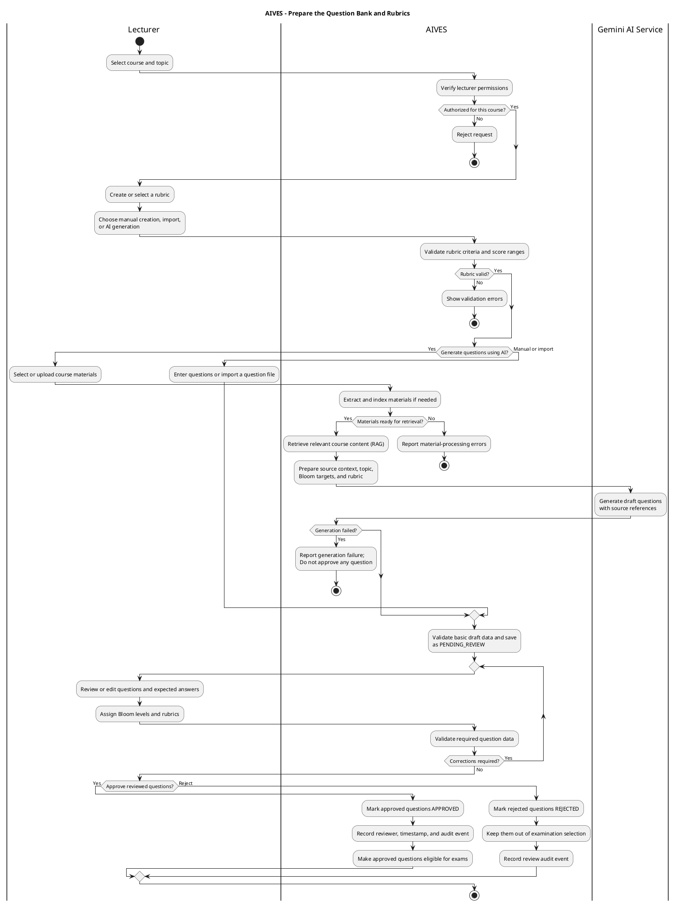
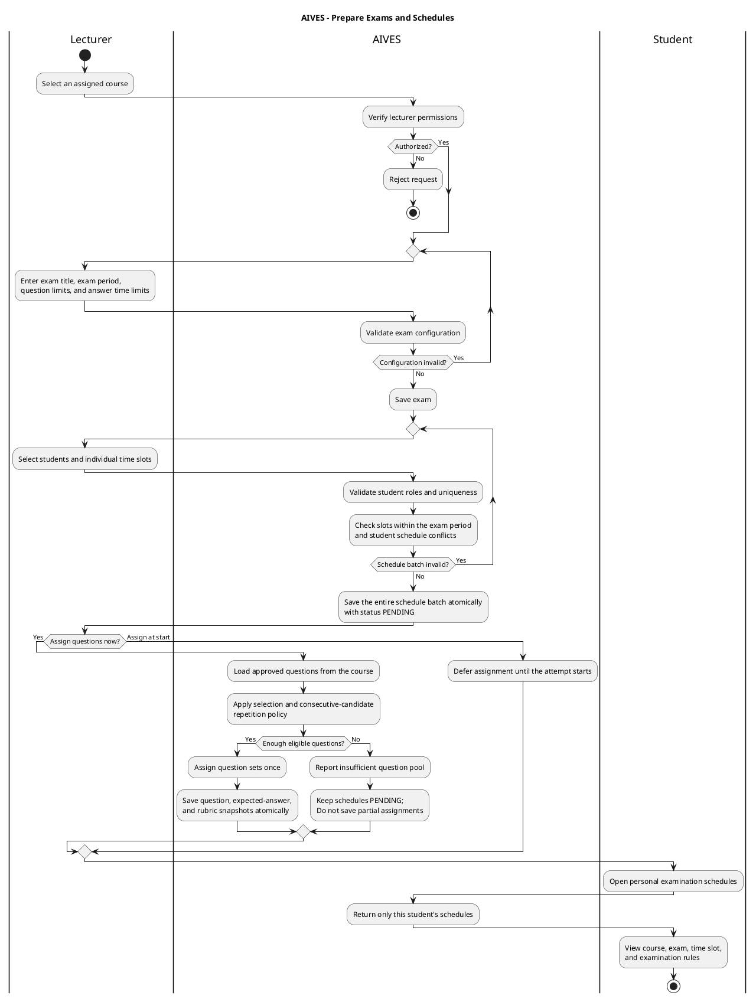
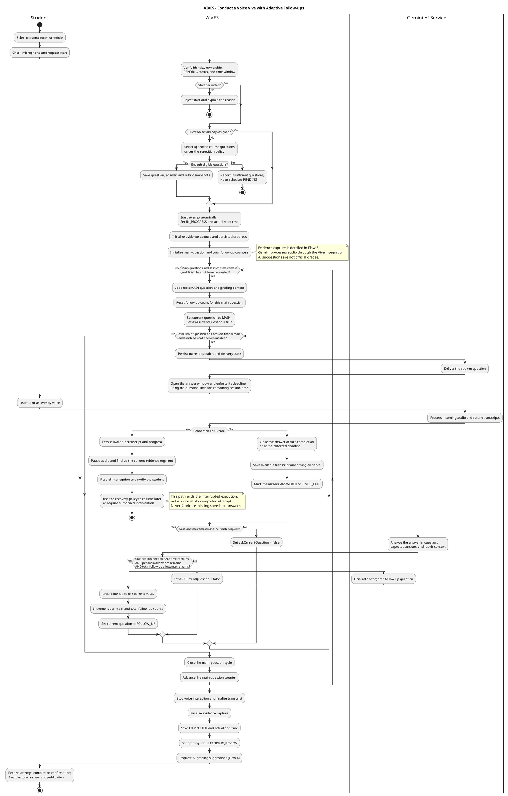
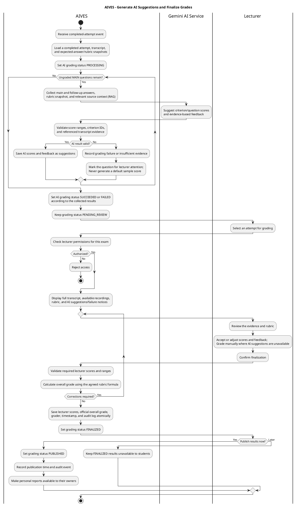
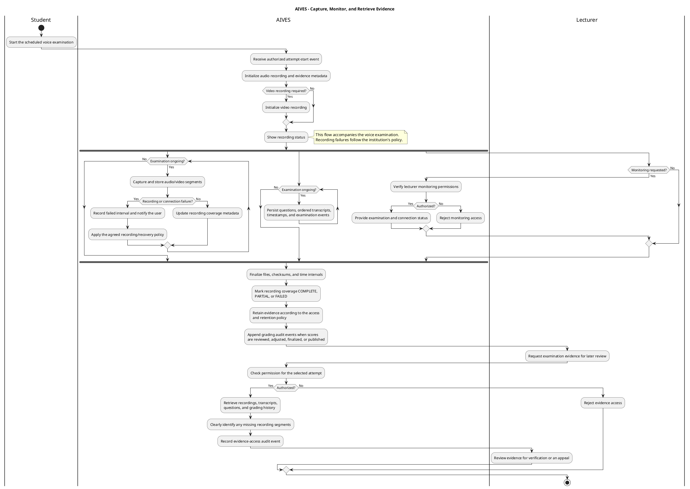
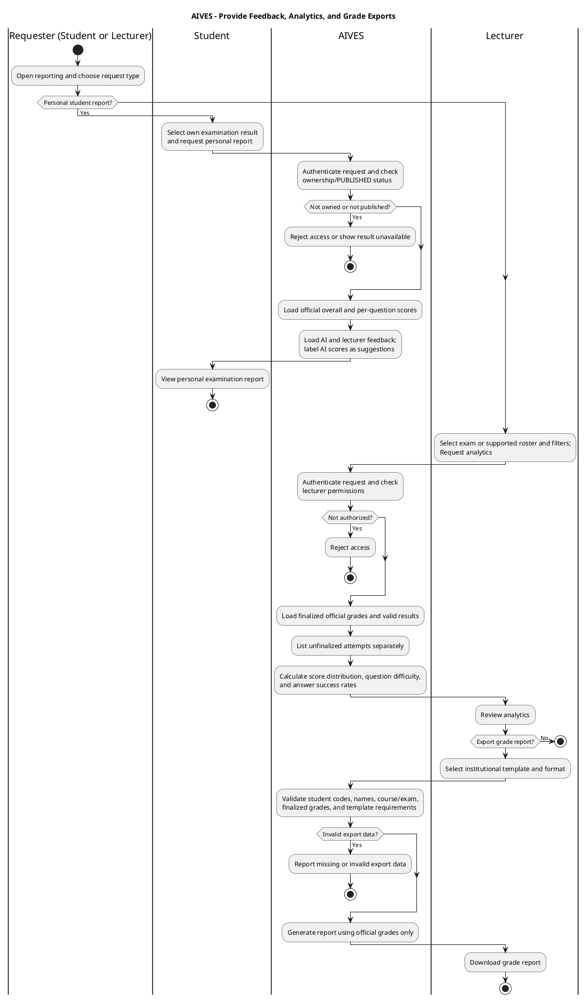
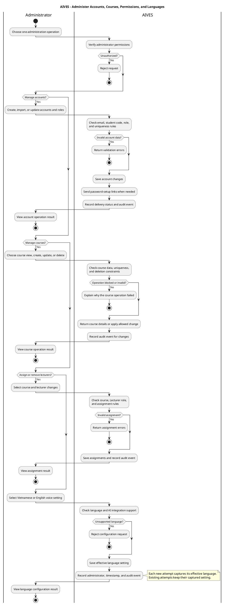

# AIVES Main Flows — PlantUML Activity Diagrams

Copy one complete `@startuml` ... `@enduml` block into a PlantUML-capable editor. For Visual Paradigm's native AI Diagram Generation text field, use the English prompts in [Main_Flows_Visual_Paradigm.md](Main_Flows_Visual_Paradigm.md).

These diagrams describe the target business design; they are not evidence of completed implementation. Gemini AI Service is the supporting service; the application's Viva integration and RAG retrieval are included in AIVES.

## Flow 01 — Prepare the Question Bank and Rubrics

[Standalone source](diagrams/main-flows/01-question-bank-and-rubrics.puml)

## Flow 02 — Prepare Exams and Schedules

[Standalone source](diagrams/main-flows/02-exam-and-schedule-management.puml)

## Flow 03 — Conduct a Voice Viva with Adaptive Follow-Ups

[Standalone source](diagrams/main-flows/03-voice-viva-and-adaptive-follow-ups.puml)

## Flow 04 — Generate AI Suggestions and Finalize Grades

[Standalone source](diagrams/main-flows/04-ai-grading-and-lecturer-finalization.puml)

## Flow 05 — Capture, Monitor, and Retrieve Evidence

[Standalone source](diagrams/main-flows/05-evidence-capture-and-review.puml)

## Flow 06 — Provide Feedback, Analytics, and Grade Exports

[Standalone source](diagrams/main-flows/06-feedback-analytics-and-grade-export.puml)

## Flow 07 — Administer Accounts, Courses, Permissions, and Languages

[Standalone source](diagrams/main-flows/07-account-permission-and-language-administration.puml)

